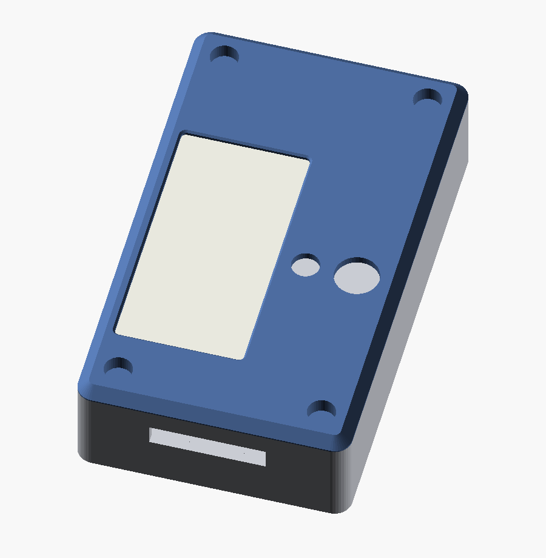
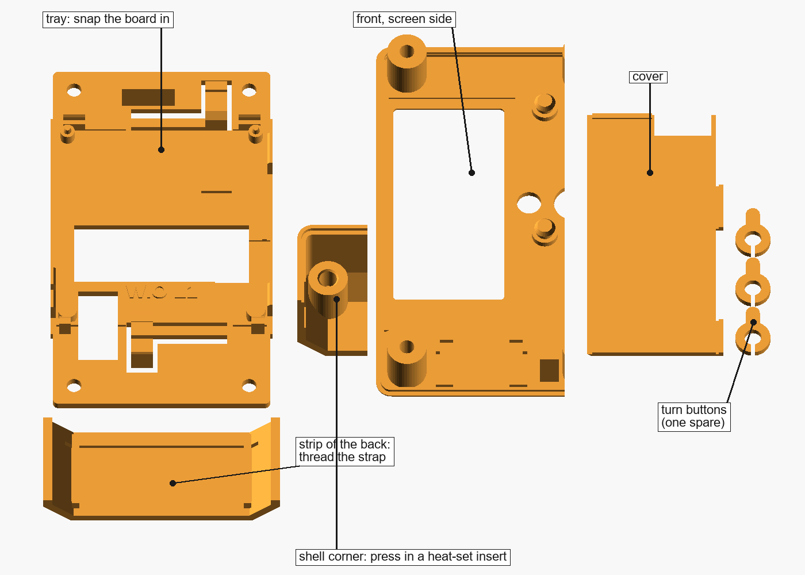
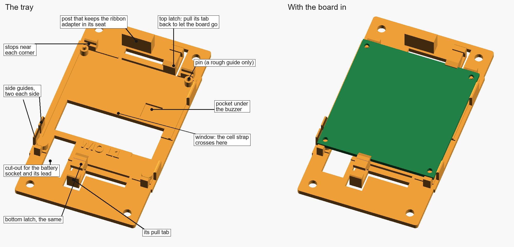
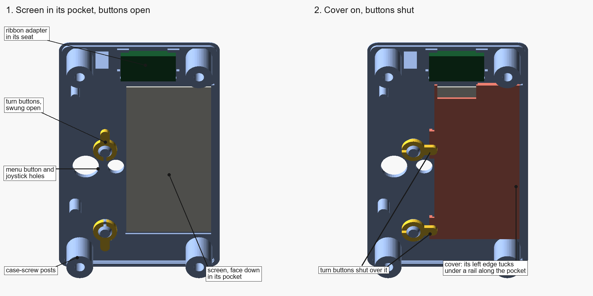
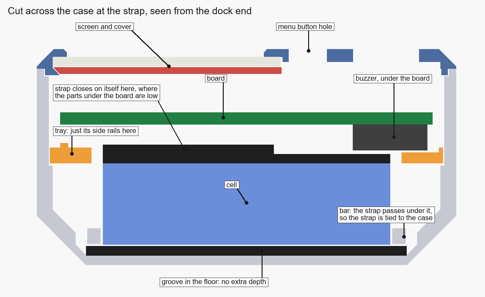
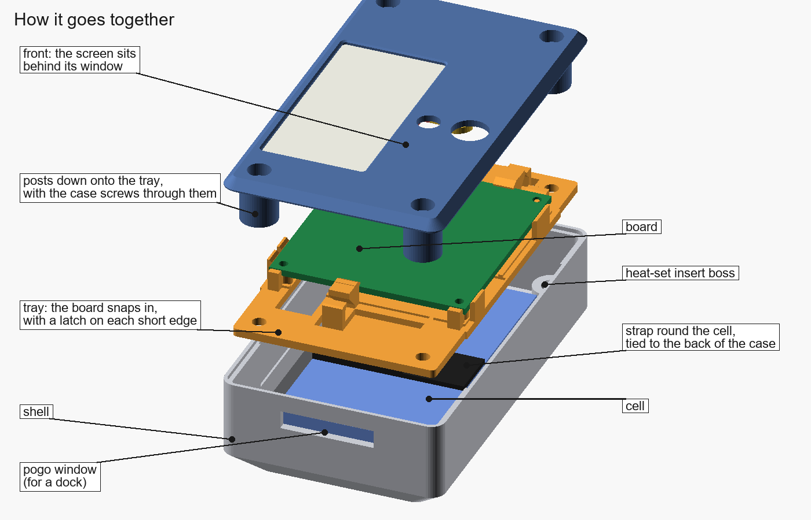
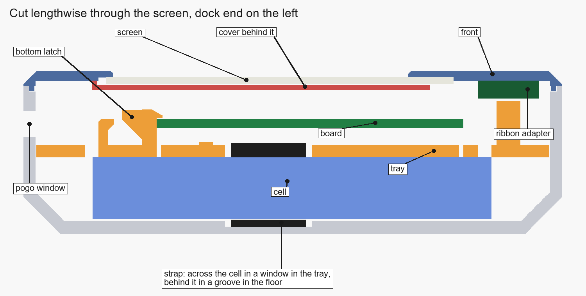

[← All projects](../README.md)

# Wio Tracker L1 case

A pocket case for a [MeshCore](https://meshcore.co.uk) tracker: Seeed's Wio Tracker L1 E-ink with its 2.13" screen, and a 3000 mAh cell. Nothing inside needs a tool. The board snaps into a tray, the screen sits under a cover held by two turn buttons, and a hook-and-loop strap ties the cell to the back of the case. Four M3 screws into heat-set inserts close it.

The shell is shared on purpose. An OLED version will only need its own front, tray and button caps.

**Status:** fit-test stage. The parts that hold the board, the screen and the cell are drawn and checked, and there's a fit test to print. The finished case isn't released yet: see [Still to do](#still-to-do).

> [!IMPORTANT]
> **Print the fit test first, and measure the few things that are still guesses.** The board's outline, thickness and screen size are measured, but a few heights aren't: the solar socket under the screen, the buzzer under the board and the LoRa antenna plug. The [build guide](docs/build-guide.md#3-measure-what-is-still-a-guess) lists them and shows where each one goes in the source.

## Pick a file

There's one file for now, the fit test. It holds a piece of every part that matters, so you can try your real board, screen, cell strap and inserts before the full case.

<table>
<tr>
<td width="55%"></td>
<td valign="top">
<a href="stl/wio-tracker-l1-eink-fit-test.stl"><code>wio-tracker-l1-eink-fit-test.stl</code></a>  
<b>Tray:</b> the whole tray, with both latches, stops, side guides and pockets. Snap the board in.  
<b>Front, screen side:</b> the screen pocket, the cover's rail, the turn-button posts and the ribbon adapter's seat.  
<b>Cover</b> and <b>three turn buttons</b> (one spare).  
<b>Shell corner:</b> one insert boss at full height, to check your iron reaches it.  
<b>Strip of the back:</b> the cell strap's groove and bars. Thread your strap through.  
About 20 cm³, 25 g of PETG. No supports.
</td>
</tr>
</table>

To print it, load it in Bambu Studio, right-click it and choose **Split > To objects**. Every piece is already lying the way it prints.

## What's in it

**Case**

- 54 × 92 mm, and 27.8 mm front to back with the 10.5 mm cell. The depth follows the cell: a 6 mm cell gives a 23.3 mm case. See [Depth and the cell](docs/customizing.md#depth-and-the-cell).
- The back shell's dock end keeps the outline of the original case, with the pogo window in the same place.
- Four M3 heat-set inserts in the shell, set 7 mm in from the outside so the iron clears the walls. M3 × 18 socket-head screws go in from the front, and their heads sit in counterbores.
- A tongue on the front plate locates it in a rebate round the shell's rim.

**Inside**

- The board snaps into a tray: a latch on each short edge, stops near each corner and two guides on each long edge. No screws.
- The tray is pocketed under the buzzer and the LoRa antenna plug, and cut away round the battery socket, where the cell's lead comes up.
- The cell lies behind the tray. A ½ in hook-and-loop strap goes round it, through a groove in the floor and under two bars, so the cell is held to the back of the case without making it any deeper.

**Screen**

- The e-ink screen lies face down in a pocket in the front. A cover goes over its back, and two turn buttons swing over the cover. Nothing presses on the glass.
- The screen's ribbon goes to Seeed's ribbon adapter, which sits in a seat above the screen. The 50 mm ribbon runs from there to the board.

## Inside

The board drops straight in, and a latch on each short edge clicks over it. To take it out, pull one latch's tab back about 1 mm and lift that edge. The latches are the Tahoe repeater's board-bay latches, unchanged apart from a shorter pull tab. Two guides on each long edge and a stop near each corner keep the board in place. The pins in the two top mounting holes only help you line it up. When the case is closed, a rib on the front sits behind the top latch's tab so it can't open, and two pads hold the board down.

The shell's side walls are 0.5 mm thinner beside the board, to make room for the guides.

## The screen

Lay the front face down and drop the screen into its pocket, ribbon toward the top. Set the cover on about 1 mm to the right, slide it left so its bevelled edge goes under the rail along the pocket, and swing the two turn buttons over it. The cover stands 0.2 mm off the glass on its own feet.

## The cell

The strap goes right round the cell. Behind it, the strap lies in a groove in the floor. Beside it, it passes under two bars, so the strap and the cell are tied to the case. Across the front, it runs through a window in the tray, where it closes on itself. The cell has 0.4 mm to spare front to back, for swelling.

## How it goes together

## Printing

PETG (or ASA), 0.4 mm nozzle, 0.2 mm layers, 4 walls, 20% infill. No supports: the 45° undersides and short bridges are drawn to print without them.

| Piece | Volume | Weight in PETG |
|---|---|---|
| Tray | 8.0 cm³ | 10 g |
| Front, screen side | 5.3 cm³ | 7 g |
| Shell corner | 2.4 cm³ | 3 g |
| Strip of the back | 2.3 cm³ | 3 g |
| Cover | 1.5 cm³ | 2 g |
| Turn buttons, three | 0.2 cm³ | under 1 g |

Bambu Studio will give you the time for your settings.

## Docs

- **[Parts list](docs/parts-list.md)**: everything to buy, plus [`parts.csv`](docs/parts.csv) for a spreadsheet.
- **[Build guide](docs/build-guide.md)**: printing and checking the fit test, measuring what's still a guess, and how the parts will go together.
- **[Changing the design](docs/customizing.md)**: the settings in the OpenSCAD source, and how to export, check and draw it.

The source is [`cad/wio-tracker-l1.scad`](cad/wio-tracker-l1.scad) (OpenSCAD 2021.01 or newer). [`cad/check_case.py`](cad/check_case.py) checks every fit, and [`cad/render.py`](cad/render.py) draws these pictures. [`PLAN.md`](PLAN.md) is the original design brief.

## Still to do

Before the full case is released:

- Openings in the side for the USB-C socket, the switch and reset.
- The SMA bulkhead for the LoRa antenna, and where the antenna lead runs. It has to clear the ribbon adapter, which now sits where the plan had the SMA.
- A seat for the GPS patch.
- Captive caps for the menu button and the joystick.
- Low ribs on the floor beside the cell, and the pogo window's plug.
- One combined STL with every printed part.
- The OLED version's front, tray and caps.

Because the case is deeper than the original, it doesn't fit the original dock. Built at the original depth (`DEPTH = 24`), it does, but then the cell can be at most about 9.2 mm thick.

## License

[CC BY-NC-SA 4.0](https://creativecommons.org/licenses/by-nc-sa/4.0/). You're welcome to build it, change it and share it for non-commercial use, as long as you give credit and share your changes under the same license. Selling prints, kits or finished units, or using the design in a paid product or service, needs my written permission first. Open an issue to ask. The full terms are in [LICENSE](../LICENSE).
