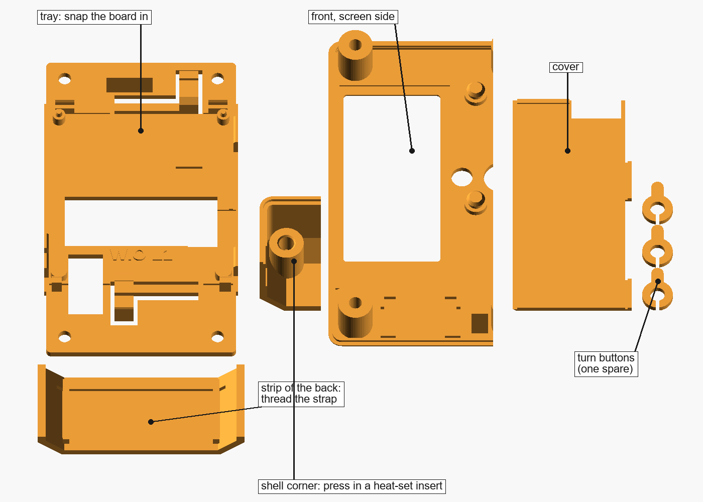
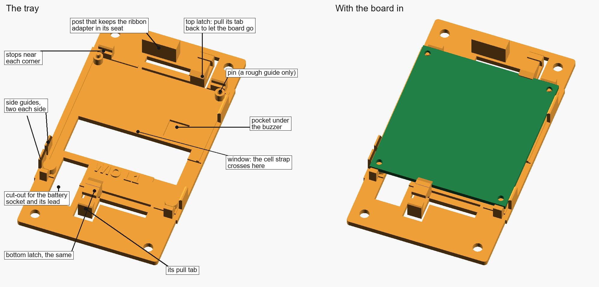
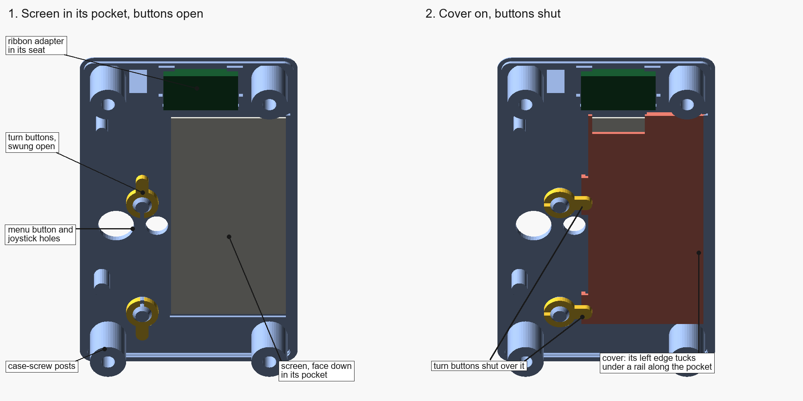
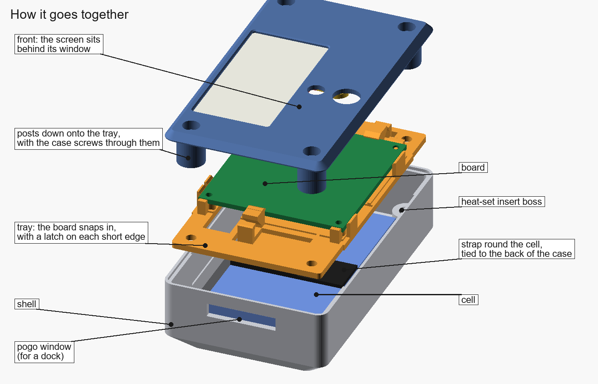
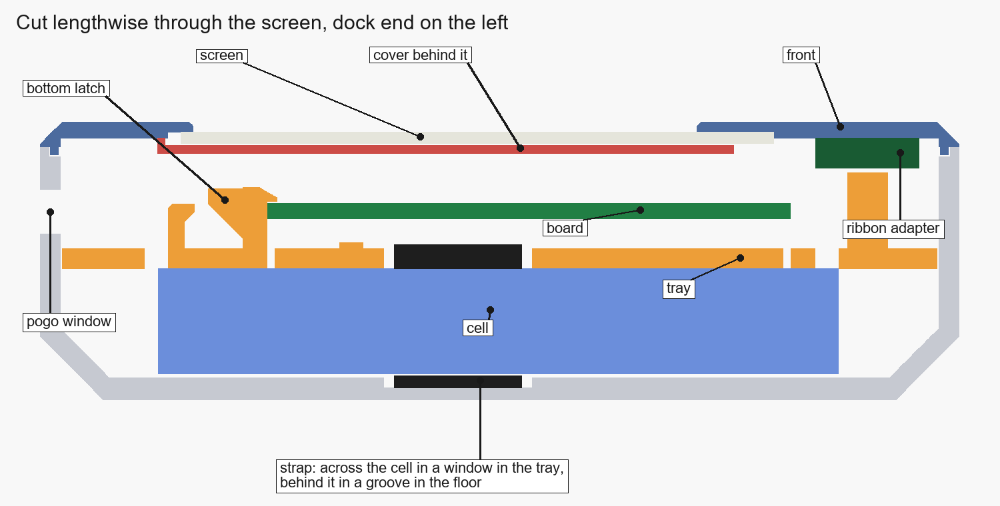

# Build guide

The full case isn't released yet ([what's left](../README.md#still-to-do)), so for now this guide covers printing and checking the fit test, measuring the few things that are still guesses, and how the parts are meant to go together.

## 1. Before you start

You need the board, its screen and ribbon adapter, a cell, four M3 heat-set inserts, an M3 screw and a strap. The [parts list](parts-list.md) has them. For the fit test you only need the board, screen, adapter, one insert, one M3 × 18 screw and the strap.

## 2. Print the fit test

Print [`stl/wio-tracker-l1-eink-fit-test.stl`](../stl/wio-tracker-l1-eink-fit-test.stl) in PETG (or ASA), 0.4 mm nozzle, 0.2 mm layers, 4 walls, 20% infill, no supports. In Bambu Studio, right-click it and choose **Split > To objects**. Every piece is already lying the way it prints, so don't turn any of them over.

## 3. Measure what is still a guess

These are set from photos or estimates. Measure them and put your numbers in [the source](customizing.md#measurements) before printing anything bigger:

- **The solar socket's height above the board** (`SOLAR_H`, set to 4.8 mm). It's the white 2-pin socket on the bottom edge, and it sits right under the screen.
- **The buzzer's height** on the underside (`UNDER`, set to 3.3 mm), and **the LoRa antenna plug's** with the antenna lead plugged in (set to 3.6 mm).
- **The tallest part on top of the board** apart from the solar socket (`TOP_TALL`, set to 5.6 mm).
- **Your cell:** thickness, width and length including its protection board (`CELL_MAX`), and **your strap's thickness** (`STRAP_T`).

Also check nothing on the board's edges sits where the tray holds it. Measured along each edge from the bottom-left corner, seen from the front:

- bottom latch: the bottom edge, 17 to 22 mm in
- top latch: the top edge, 34 to 39 mm in
- stops: the bottom edge 0.6 to 3.2 mm and 44.5 to 47.5 mm in, and the top edge 1.5 to 6.5 mm and 41.5 to 46.5 mm in
- side guides: the left edge 2 to 6.5 mm and 8 to 12.5 mm up, and the right edge 2.5 to 8.5 mm and 40 to 48 mm up

## 4. Check the fit

**Tray and board.** Hold the board over the tray, components up, with the battery socket over the cut-out, and press it straight down. Both latches should click over its edges. It shouldn't move sideways: the guides on the long edges and the stops at the corners hold it, and the pins in its top holes should be loose. To take it out, pull one latch's tab back about 1 mm and lift that edge. If a latch won't click, or the board rocks, see [Troubleshooting](#troubleshooting).

**Shell corner.** Press an M3 insert into the boss with your iron. The iron should go straight down without touching the walls. Then screw an M3 screw into it. If the insert goes in too easily or the plastic bulges, change `INSERT_HOLE_D`.

**Strip of the back.** Thread your strap under the bars and through the groove. It should slide through without forcing, and lie flat in the groove.

**Front, screen and cover.**

1. Lay the front face down and drop the screen into its pocket, face down, ribbon toward the top. It should drop in without forcing, with a little room all round.
2. Seat the ribbon adapter in its four corners above the screen, and plug the screen's ribbon into it.
3. Snap the turn buttons onto their posts: press each one's split hub over the post's head.
4. Set the cover on about 1 mm to the right of where it goes, then slide it left so its bevelled edge goes under the rail along the pocket.
5. Swing both turn buttons over the cover. It should sit just off the glass, held without any pressure on it.

**All together.** Put the tray on the shell corner's boss, then the front over it, and screw them together with the M3 × 18. The screw's head should sit flush in its counterbore.

## 5. How it will go together

This is the order the parts are drawn for. It'll be confirmed when the full case is printed.

1. Press the four inserts into the shell's bosses.
2. Lay the strap across the shell's floor, through the groove and under both bars, with its ends up both sides.
3. Lay the cell on the strap, lead toward the dock end. Wrap the strap over the cell and close it on itself on the left of the cell's front.
4. Snap the board into the tray, plug in the cell's lead through the cut-out, and lay the tray in the shell over the cell.
5. Fit the screen, adapter, cover and turn buttons in the front as in step 4 above, and plug the long ribbon into the adapter.
6. Plug the long ribbon into the board's E-INK connector, fold it back over the adapter, and lay the front on.
7. Screw the front on with four M3 × 18 screws.

## Troubleshooting

- **A latch won't click over the board.** Your board may be thicker than 1.57 mm: measure it and set `PCB_T`.
- **The board rocks or moves sideways.** Check the guides and stops aren't sitting on something at the board's edge. If the board is smaller than 47.96 × 52.24 mm, set `BOARD`.
- **Something on the underside touches the tray.** Measure it and add it to `UNDER`; the tray gets a pocket under it.
- **The screen won't drop in, or rattles.** Change `PANEL_CLR` (0.6 mm by default).
- **The cover won't slide under the rail, or lifts.** Change `RAIL_CLR`.
- **The strap is tight under the bars.** Set `STRAP_T` to your strap's thickness.
- **The insert is loose or the boss cracks.** Change `INSERT_HOLE_D`, between 3.8 and 4.2.
