[← All projects](../README.md)

# XIAO node case

A desk case for one, two or three [MeshCore](https://meshcore.co.uk) nodes built on Seeed's XIAO ESP32S3 & Wio-SX1262 kit. Each kit gets its own bay with its own USB-C port, and its LoRa antenna stands straight up out of the lid on an SMA connector.

I built it to run two nodes side by side at the lake: one that Home Assistant talks to over WiFi, and one that feeds a CoreScope observer. The single-kit shells I tried before tipped over as soon as a real antenna went on, so this one sits on a weighted base. Nothing needs tools: the boards click into their bays, the lid clips onto a hinge, and the base slides on and locks.

<table>
<tr>
<td width="33%">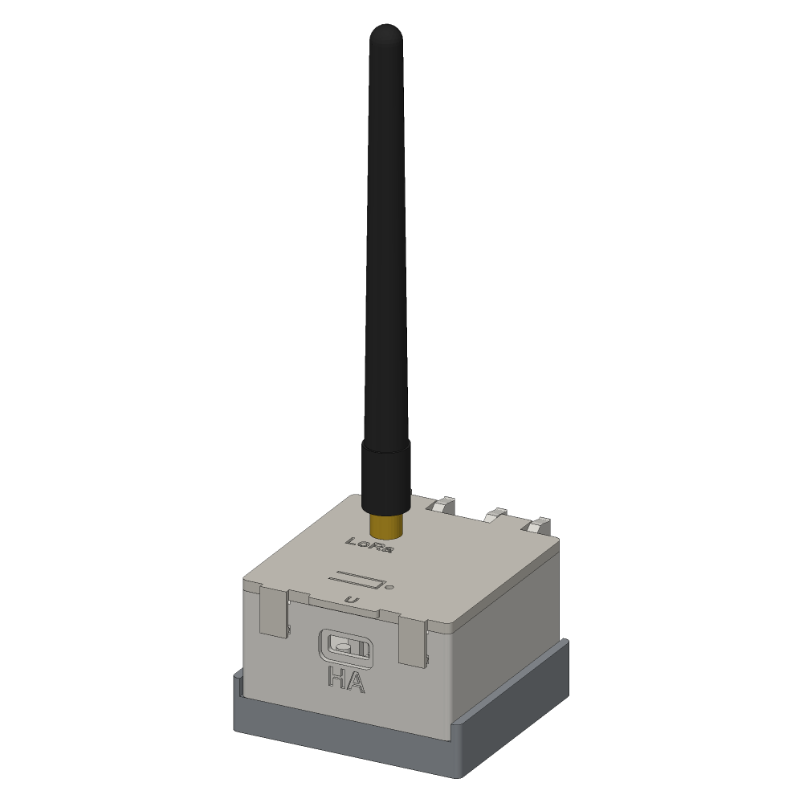</td>
<td width="33%">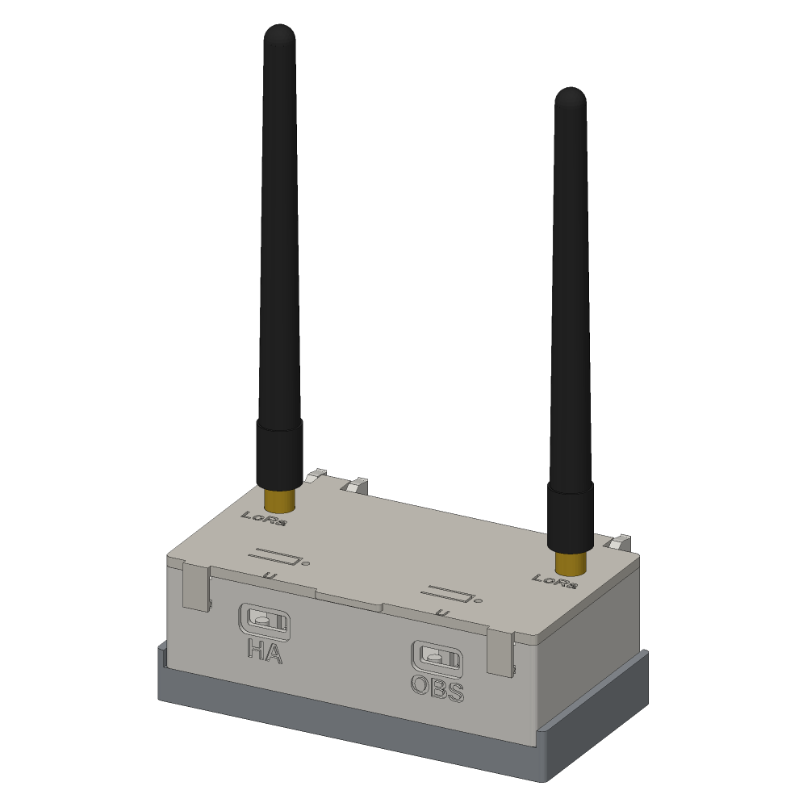</td>
<td width="33%">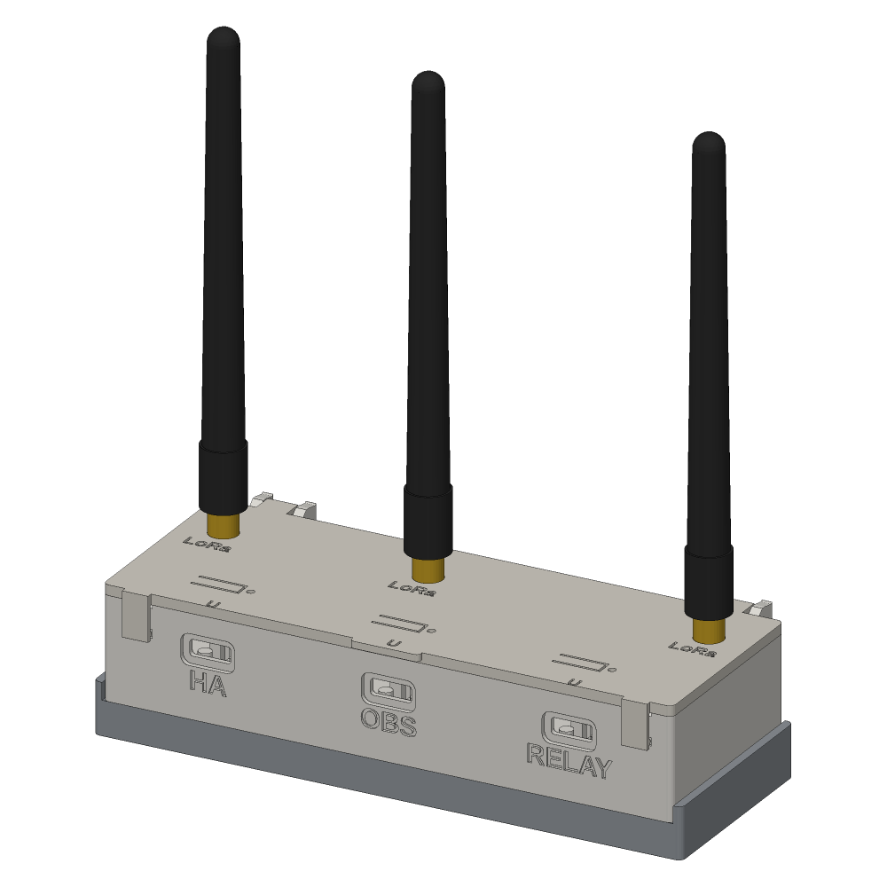</td>
</tr>
<tr>
<td valign="top"><b>1 bay.</b> One node. 53 × 57 × 34 mm.</td>
<td valign="top"><b>2 bays.</b> Two nodes, with their LoRa antennas in the lid's back corners, as far apart as the case allows. 95 × 57 × 34 mm. This is the one I use.</td>
<td valign="top"><b>3 bays.</b> Three nodes, antennas at both ends and near the middle. 137 × 57 × 34 mm.</td>
</tr>
</table>

Sizes are width × depth (including the hinge at the back) × height, without antennas.

> [!IMPORTANT]
> **Use a thin, floppy antenna pigtail.** The Wio board's LoRa connector is a tiny U.FL, and a stiff pigtail (RG178 or RG316) bent into the case levers it straight off. Get one with **1.13 mm** cable, about 10 cm long. The [parts list](docs/parts-list.md) has a link.

## Pick a file

There's one file for each size. Each holds every printed part for that size: the case body, the lid and the base plate. Click a picture to open the file in GitHub's 3D viewer. To print one, load it in Bambu Studio, right-click it and choose **Split > To objects**.

<table>
<tr>
<th>1 bay</th>
<th>2 bays</th>
<th>3 bays</th>
</tr>
<tr>
<td align="center"><a href="stl/xiao-node-case-1bay.stl">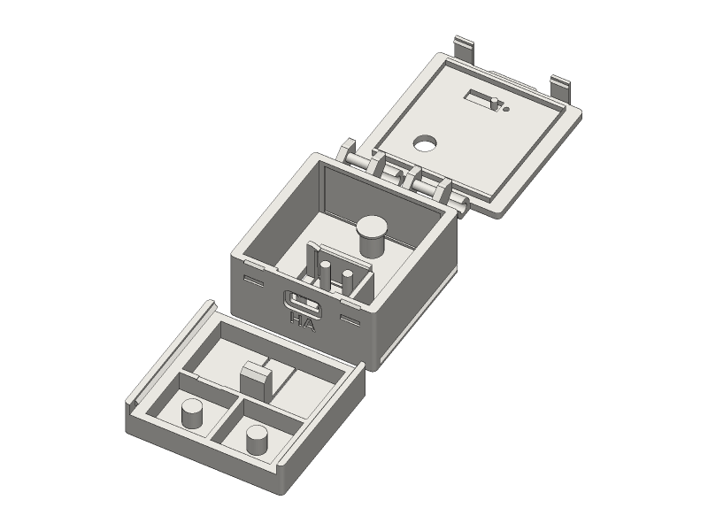</a> <a href="stl/xiao-node-case-1bay.stl"><code>xiao-node-case-1bay.stl</code></a></td>
<td align="center"><a href="stl/xiao-node-case-2bay.stl">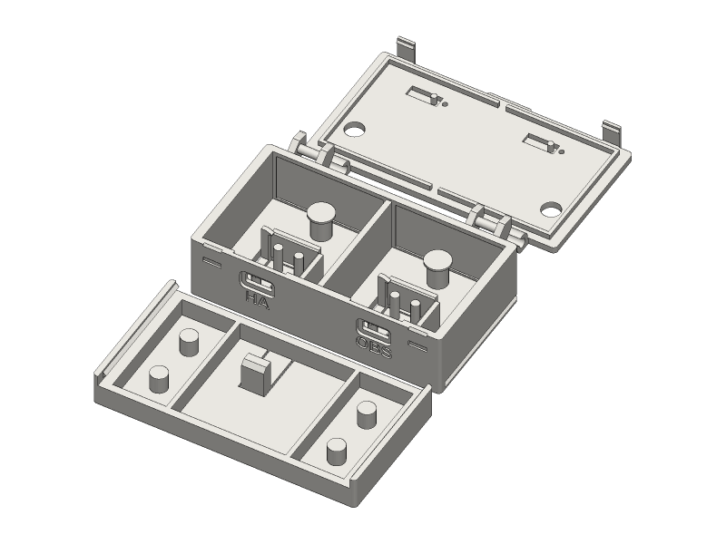</a> <a href="stl/xiao-node-case-2bay.stl"><code>xiao-node-case-2bay.stl</code></a></td>
<td align="center"><a href="stl/xiao-node-case-3bay.stl">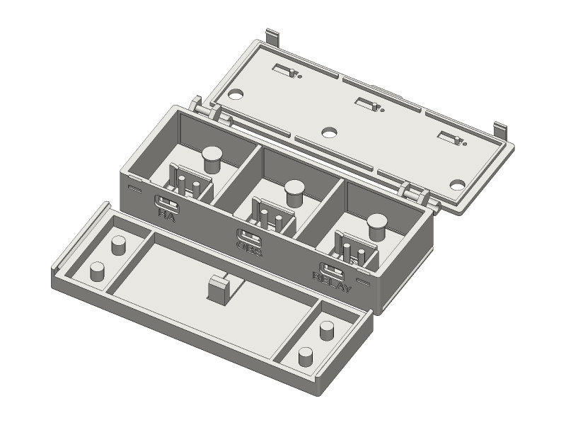</a> <a href="stl/xiao-node-case-3bay.stl"><code>xiao-node-case-3bay.stl</code></a></td>
</tr>
</table>

There's also a [fit test](stl/xiao-node-case-fit-test.stl): one bay's floor and front wall, with a strip of lid over it. It uses a fraction of the plastic, so print it first if you've changed anything, or if your kit might not match mine. See [Check the fit](docs/build-guide.md#3-check-the-fit).

The bays are labelled **HA**, **OBS** and **RELAY** under their USB-C ports. To use your own labels, change one line and export again ([Changing the design](docs/customizing.md)).

## What every file has in common

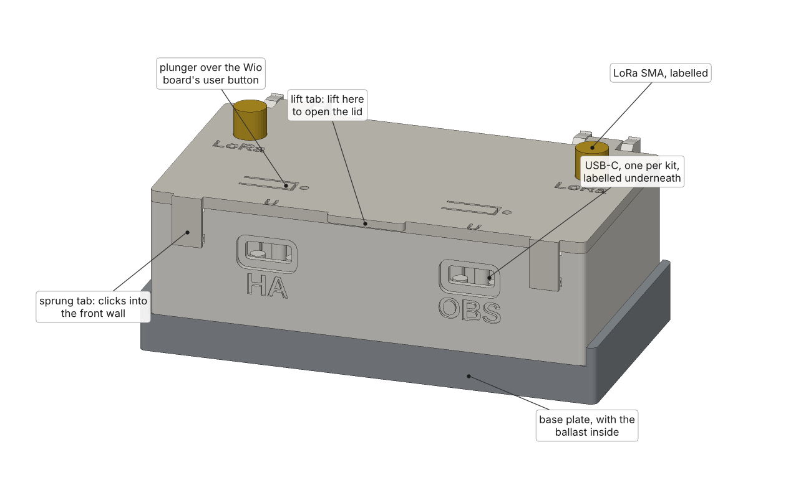

**The case**

- A USB-C opening for each kit in the front wall, with its label debossed underneath. The kit's socket sits right in the wall, and there's room around it for a normal cable's boot.
- A bay for each kit, held without screws (see [The board bays](#the-board-bays)).
- The XIAO's B (boot) and R (reset) buttons sit under the Wio board, so to press them you unclip the kit, which takes a few seconds.
- PETG, no supports, rounded corners so they stay down on the bed.

**The lid**

- One piece, hinged at the back. It clips onto two pins on the case without tools and opens to about 100°, where it rests on its own.
- Two sprung tabs at the front corners click into the front wall. Lift the tab in the middle of the front edge to open it.
- A flexure plunger over each Wio board's user button (marked **U**), so you can press it with the lid shut, and a window over its LED.
- An SMA bulkhead hole for each kit's LoRa antenna, labelled **LoRa**, with the antennas spread as far apart as the lid allows so the radios don't swamp each other.

**WiFi antenna**

- By default each kit's stock flexible (FPC) WiFi antenna sticks to the back wall of its bay, in a shallow pocket, and its cable winds on a spool behind the board.
- Or, with one setting, an RP-SMA bulkhead on the lid for an external WiFi antenna instead, labelled **WiFi** ([Changing the design](docs/customizing.md#wifi-antenna)).

**The base**

- An open tray that slides onto the bottom of the case from the back. A lip up each side runs in a V-groove along the case's side walls.
- M6 fender washers on pins, 4 per stack: 4 stacks on the 2- and 3-bay, 2 on the 1-bay. The 2- and 3-bay bases also have an open chamber in the middle for anything else heavy. This is what keeps it upright with full-size antennas.
- A sprung catch in the middle clicks up through a slot in the case's floor when the base is home. To take the base off, open the lid, press the catch down and slide the base out the back.

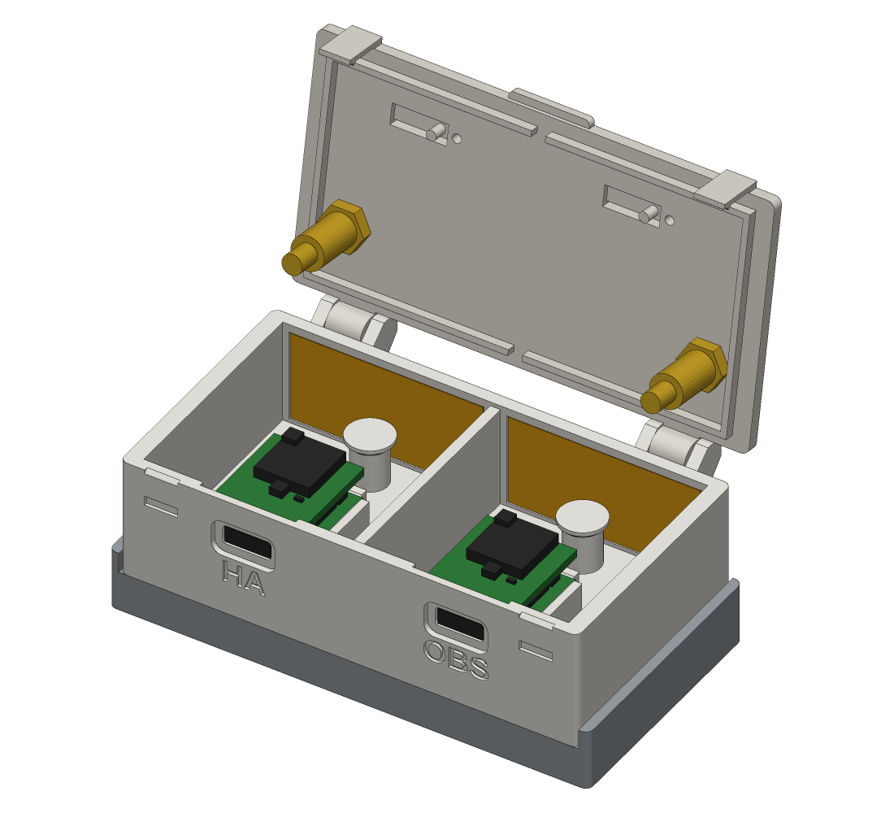

## The board bays

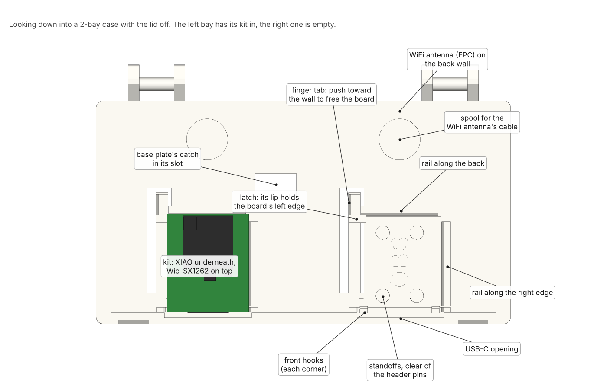

Each bay holds the XIAO, the bottom board of the kit, the same way the boards on the [Tahoe repeater](../tahoe-repeater/)'s sled are held:

- **Standoffs** under the XIAO, between its header rows, so the factory-soldered header pins hang clear of the floor and never get pushed back up through the board.
- **Two hooks** on the front wall reach over its front corners. They stop short of the B and R buttons beside the USB-C.
- **A latch** on its left edge: a lip on a tongue cut into the floor, which springs sideways. It snaps over the board when you press it down. A finger tab beside it pulls it back.
- **Rails** along the right and back edges. The latch pushes the board against the right one, and plugging in a USB-C cable pushes it against the back one, so the cable never loads the latch.

To put a kit in, slide its front edge under the hooks with the back raised, then press the back down until it clicks. To take it out, push the finger tab toward the side wall and lift.

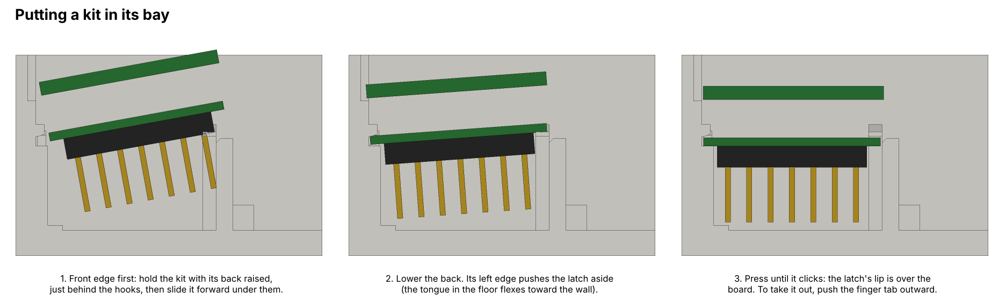

## Inside, in section

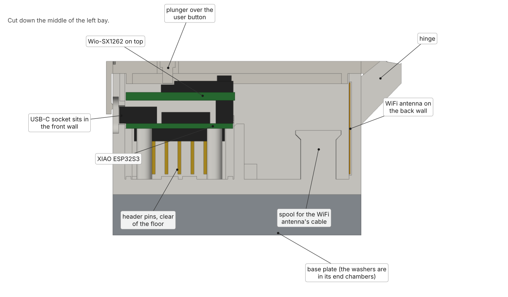

## The base

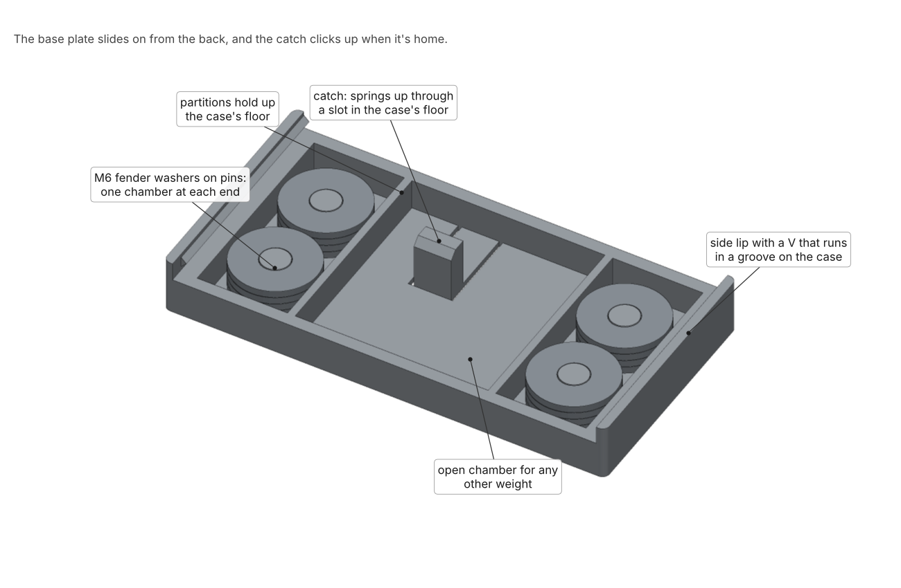

## Printing

- **PETG**, which is what I print it in. 0.4 mm nozzle and 0.2 mm layers; walls and infill aren't critical, so 3 walls and 15 to 20% infill is plenty. ASA works too.
- **No supports.** The body prints floor down, the lid upside down, the base right way up. That's how they're laid out in the files.
- **Big flat parts can lift at a corner.** If yours do, use the textured PEI plate with a little glue stick, and a brim or Bambu Studio's "Mouse ear" brim.
- On a Bambu P1S, keep the front door shut and prop the top glass open a little for PETG.

## More

- [Parts list](docs/parts-list.md): everything to buy, with links ([`parts.csv`](docs/parts.csv) as a spreadsheet)
- [Build guide](docs/build-guide.md): printing, fitting the kits, the antennas, the lid and base, and setting the nodes up in MeshCore and Home Assistant
- [Changing the design](docs/customizing.md): labels, the WiFi option, and exporting your own files

**Status:** design revision 3. I use the 2-bay. The 1- and 3-bay files come from the same design and pass the same checks, but I haven't printed them.

## License

[CC BY-NC-SA 4.0](../LICENSE). Build it, change it and share it for non-commercial use, with credit and under the same license. Selling prints, kits or finished units needs my written permission first.

The Wio-SX1262 STEP file in `stl/` is Seeed Studio's, included only as a reference for the board's dimensions.
