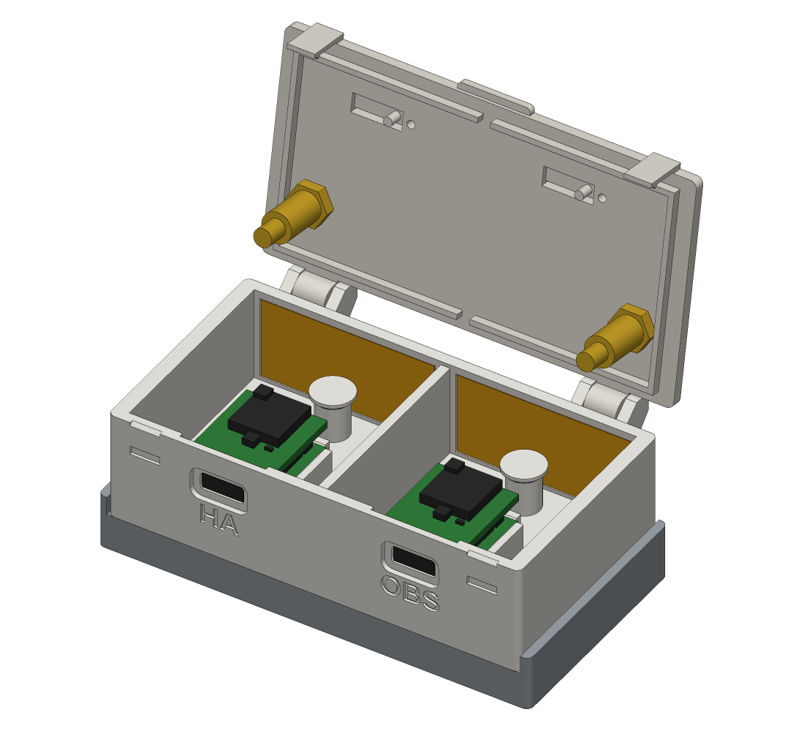
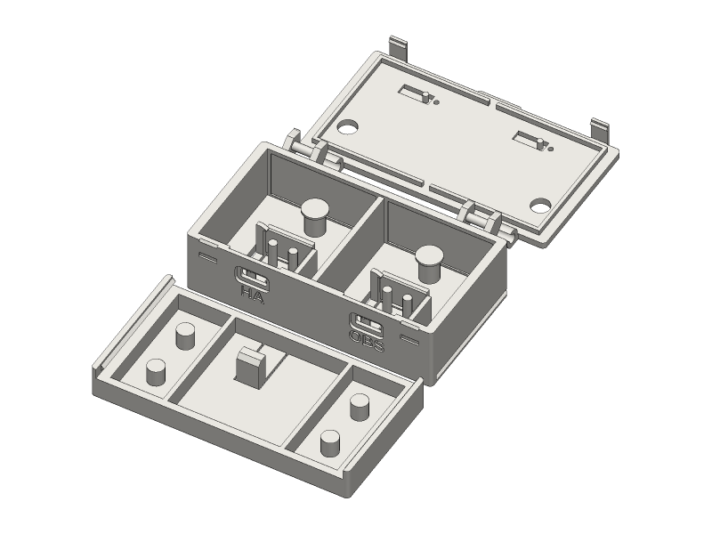
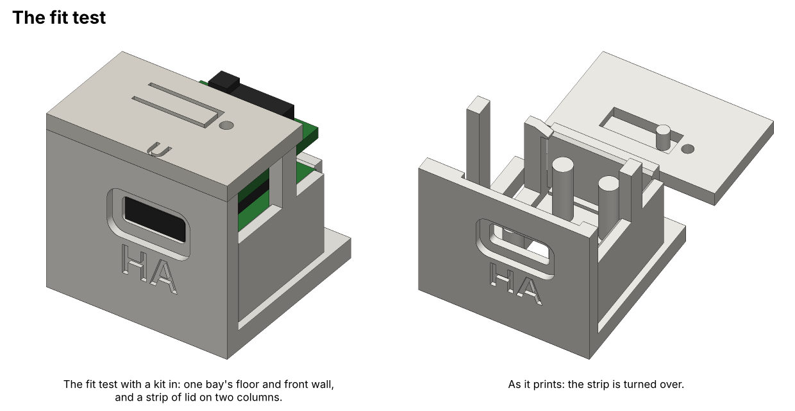
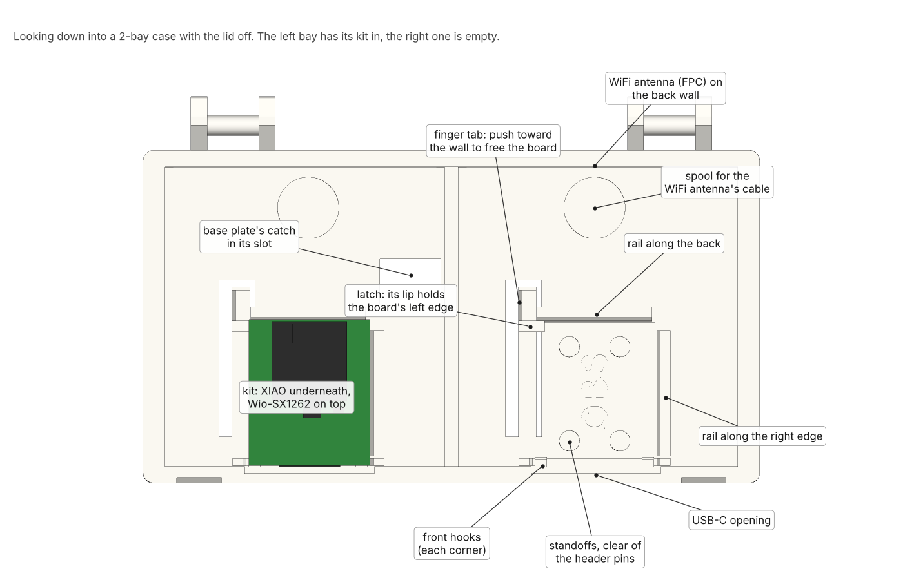
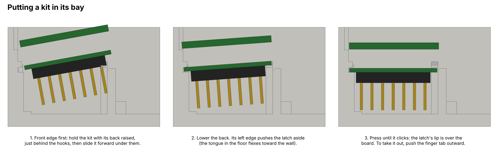
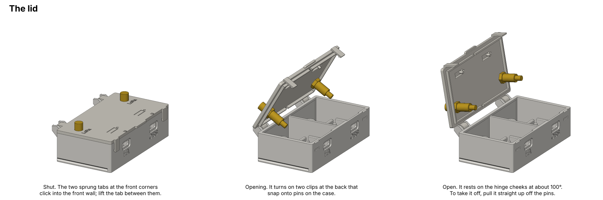
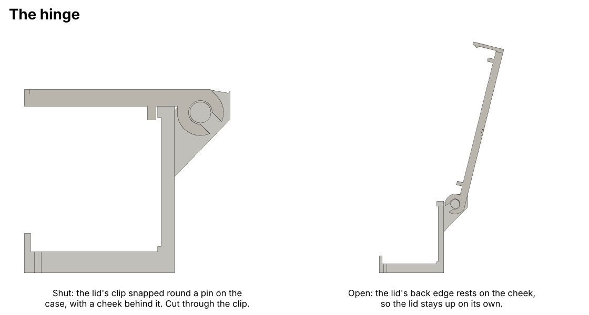
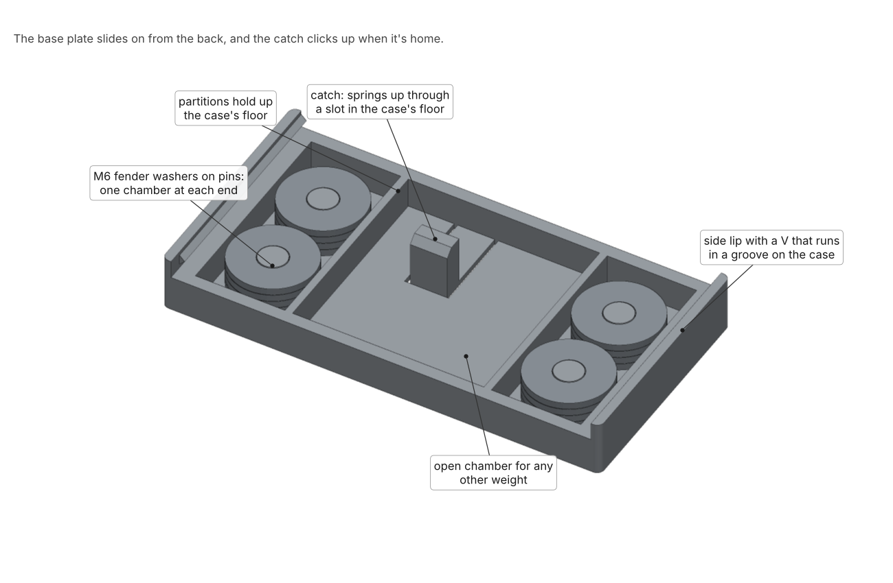

# Build guide

The whole build, start to finish. It's short: there's no soldering and no screws. The pictures are drawn from the CAD.

Everything here applies to all three sizes. The pictures show the 2-bay.

- [1. Before you start](#1-before-you-start)
- [2. Print the parts](#2-print-the-parts)
- [3. Check the fit](#3-check-the-fit)
- [4. Fit the antennas to the lid](#4-fit-the-antennas-to-the-lid)
- [5. Put the kits in](#5-put-the-kits-in)
- [6. The WiFi antennas](#6-the-wifi-antennas)
- [7. Connect the pigtails and fit the lid](#7-connect-the-pigtails-and-fit-the-lid)
- [8. Fill and fit the base](#8-fill-and-fit-the-base)
- [9. Set up MeshCore](#9-set-up-meshcore)
- [10. Opening it later](#10-opening-it-later)
- [11. Troubleshooting](#11-troubleshooting)

## 1. Before you start

1. **Pick your file.** The [README](../README.md#pick-a-file) shows the three sizes.
2. **Get the parts.** The [parts list](parts-list.md) is a checklist. The one thing to get right is the LoRa pigtail: **1.13 mm** cable, SMA female, U.FL (MHF1) on the other end.
3. **Flash the kits first, if you can.** Flashing needs the B button on the XIAO, which is under the Wio board. It's easy to unclip a kit to reach it, but it's quicker to do before it goes in. See [Set up MeshCore](#9-set-up-meshcore).

## 2. Print the parts

Load your file in Bambu Studio, right-click it and choose **Split > To objects**. You get three parts: the body, the lid and the base plate. They all fit on one 256 mm plate, laid out as they are.

- **PETG** (or ASA), 0.4 mm nozzle, 0.2 mm layers. 3 walls and 15 to 20% infill is plenty.
- **No supports.** Leave the parts the way they are in the file. The lid prints upside down, with its hinge clips and front tabs standing up.
- **Corners lifting.** The base and the body are wide and flat, and PETG can lift a corner. Use the textured PEI plate, wash it with dish soap, and add a thin layer of glue stick. If a corner still lifts, add a brim (Bambu Studio's "Mouse ear" brim type is enough).
- **PETG on a P1S:** keep the front door shut and prop the top glass open a little.

After printing, check the latch in each bay: it's a tongue cut free in the floor, beside the board's left edge. The slot round it should be clean, and the tongue should flex sideways when you push it.

## 3. Check the fit

The [fit test](../stl/xiao-node-case-fit-test.stl) is one bay's floor and front wall, with a strip of lid on two columns. It takes a fraction of the plastic of a full case. Print it if you've changed the design, if you're trying a new filament, or if your kit might differ from mine.

Put a kit in, the way [step 5](#5-put-the-kits-in) shows, and check:

- The kit drops in flat and the latch clicks over its left edge. Its back edge should sit **behind** the rail along the back, not on top of it.
- The USB-C socket sits in its opening, and a cable plugs in without pushing the board up.
- Lay the strip of lid on the columns. Pressing the **U** plunger should click the Wio board's user button, and you should see its LED through the small window.

If the board rides up onto the back rail, something is stopping it sliding all the way forward under the front hooks. The usual cause is the hooks landing on the B and R buttons beside the USB-C. See [Troubleshooting](#11-troubleshooting).

## 4. Fit the antennas to the lid

Each LoRa pigtail's SMA bulkhead goes through a hole marked **LoRa** in the lid. Push it up through the hole from underneath, so the threaded end sticks out of the top. Then fit its washer and nut on top and tighten them by hand, then a little more with a small wrench. Don't overtighten into plastic.

With the RP-SMA WiFi option, the WiFi pigtails go in the holes marked **WiFi** the same way.

Leave the antennas themselves off until the case is closed.

## 5. Put the kits in

Each kit goes into its bay with the USB-C socket toward the front wall:

1. Hold the kit with its back raised and its front edge just behind the two hooks on the front wall.
2. Slide it forward so the front edge goes under the hooks, and the USB-C socket goes into its opening.
3. Lower the back. The board's left edge pushes the latch aside.
4. Press the back down until it clicks. The latch's lip is now over the board's left edge, and the board is pushed against the rail on its right.

To take a kit out, push the finger tab beside the latch toward the side wall, lift the back of the board and slide it out from under the hooks.

## 6. The WiFi antennas

Skip this with the RP-SMA option.

Each kit's stock FPC WiFi antenna goes on the back wall of its bay, in the shallow pocket there:

1. Plug its U.FL into the XIAO's WiFi connector. It's on the XIAO's top face, under the Wio board, so do this before the kit goes in, or unclip the kit.
2. Peel the backing and stick the antenna in the pocket on the back wall.
3. Wind the spare cable loosely round the spool behind the board. About one turn takes up the slack.

## 7. Connect the pigtails and fit the lid

1. **Connect each LoRa pigtail.** Plug its U.FL onto the Wio board's LoRa connector: line it up squarely over the socket and press straight down with a fingernail or the flat of a small screwdriver until you feel a click. Let the cable leave the connector straight up for a few millimetres before it bends. If a connector won't stay on, see [Troubleshooting](#11-troubleshooting).
2. **Fit the lid.** Hold it upright behind the case, with its two clips over the two pins on the back. Press it down until both clips snap onto their pins.
3. **Close it.** Swing it shut. The two sprung tabs at the front corners click into the front wall.
4. **Fit the antennas.** Screw a LoRa antenna onto each SMA on the lid.

> [!WARNING]
> Always fit the antennas before you power a node. A radio that transmits with nothing on its antenna connector can damage itself.

## 8. Fill and fit the base

1. **Ballast.** Stack 4 M6 fender washers on each pin. On the 2- and 3-bay, anything else heavy can go in the open middle chamber, such as steel shot in a small bag, as long as nothing sticks up above the plate's rim.
2. **Slide it on from the back.** Turn the case upside down, line up the base's two side lips with the grooves at the back of the case's side walls, and slide it forward. Near the end the catch rides up a ramp, then clicks up through a slot in the case's floor. The grooves stop the base flush with the front.

To take the base off, open the lid, press the catch down (it's behind the board, in the middle bay, or just left of the divider on the 2-bay) and slide the base out the back.

## 9. Set up MeshCore

This is how I set up my two nodes: one that Home Assistant talks to, and one that feeds CoreScope. Your setup may differ.

### Flash

1. Go to [flasher.meshcore.io](https://flasher.meshcore.io) in Chrome or Edge, and pick **Xiao S3 WIO → Companion Bluetooth**, version **1.18.0 or newer**, with erase on. On the XIAO S3, that build does Bluetooth and WiFi at the same time.
2. Put the XIAO in download mode: unplug it, hold **B** and plug the cable back in, then let go. Pick the port that appears and flash.

If it says *Failed to initialize*, the board wasn't in download mode or the browser picked the wrong port. Try again, and use a USB cable you know carries data.

### Set it up

In the MeshCore app, connect to the node over Bluetooth (the default PIN is 123456) and set:

- **Name**, for example "Lake HA".
- **Location**: long-press on the map. The kit has no GPS, and doesn't need one.
- **Radio settings**: the same preset as the mesh around you. Every node in the case must use the same one. Copy the values from the app's preset list rather than typing them.
- **Channels**: your private channels, and Public if you want it.
- **WiFi**: your network's name and password, under Settings → WiFi. It has to be a 2.4 GHz network.

Then give each node a fixed IP address on your router. It listens on TCP port 5000.

> [!CAUTION]
> The TCP port has no password or encryption. Anyone who can reach it can read the node's messages and send as it. Keep the nodes on a network only your own devices can reach.

### Home Assistant

Install [meshcore-ha](https://github.com/meshcore-dev/meshcore-ha) through HACS, then add it under **Settings → Devices & Services**, connecting over **TCP** to the node's IP and port 5000. Each node is its own entry.

- **Messages** land in Home Assistant's Logbook and fire a `meshcore_message` event you can automate on. For a chat window, add [MeshCore Companion Cards](https://github.com/RikoDEV/ha-meshcore) as well.
- **Your phone and Home Assistant can share a node**: Home Assistant over WiFi, the phone over Bluetooth. Incoming messages wait in one queue, and whichever reads them first takes them. If you'd rather the phone gets them, turn off **Retrieve queued incoming messages** in meshcore-ha's settings.
- **Settings remotely**: meshcore-ha's `execute_command` action, or its CLI console, can change a node's name, radio settings, power and channels. Change every node in the case at the same time, or they'll stop hearing each other.

### CoreScope (optional)

[CoreScope](https://github.com/Kpa-clawbot/CoreScope) maps your mesh from packets that observer nodes send it over MQTT. meshcore-ha can do that from the same node: under **Manage MQTT Brokers**, add CoreScope's broker with its username and password, leave **Payload Mode** on Packet, and set **Broker IATA Code** to your nearest airport code. If you'd rather the feed didn't depend on Home Assistant, use a second node with [meshcore-packet-capture](https://github.com/agessaman/meshcore-packet-capture).

## 10. Opening it later

- **Lid:** lift the tab in the middle of the front edge. It opens to about 100° and stays there. To take it off completely, hold it upright and pull it straight up off its pins.
- **A kit:** disconnect its U.FL pigtail, push the finger tab beside the latch toward the side wall and lift the board out.
- **Base:** with the lid open, press the catch down through its slot and slide the base out the back.

## 11. Troubleshooting

**The board won't drop in, and its back sits on top of the back rail.** Something is stopping it going fully forward under the front hooks. Check the front corners: the XIAO's B and R buttons sit beside the USB-C, close to the front edge, and a hook that reaches over them holds the board back. The hooks in the current files stop short of them. On an older print, shave about 0.5 mm off the inner end of each front hook (the end nearest the USB-C) with a hobby knife.

**The LoRa pigtail's U.FL keeps popping off.** U.FL connectors hold on by a light snap, and any sideways pull from the cable takes them off. Use a pigtail with 1.13 mm cable, not RG178 or RG316. Seat it with a straight push until it clicks. A plug that has been on and off many times can lose its grip; a new pigtail fixes that. If it still comes off, put a strip of Kapton tape over it.

**The lid won't stay shut.** Check both sprung tabs click into the recesses in the front wall. They're thin, so if one has snapped, print a new lid.

**A node drops off WiFi.** It needs a 2.4 GHz network with WPA2. WPA3-only networks and some fast-roaming settings don't work well with the ESP32. If you entered the WiFi details wrong, connect over Bluetooth and fix them in the app.

**Two nodes can't hear each other.** Check they're on exactly the same radio settings.
